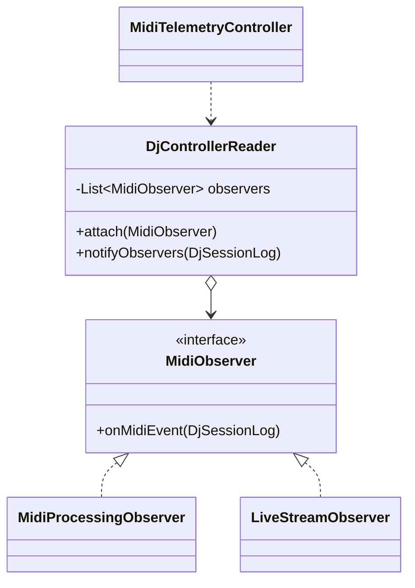
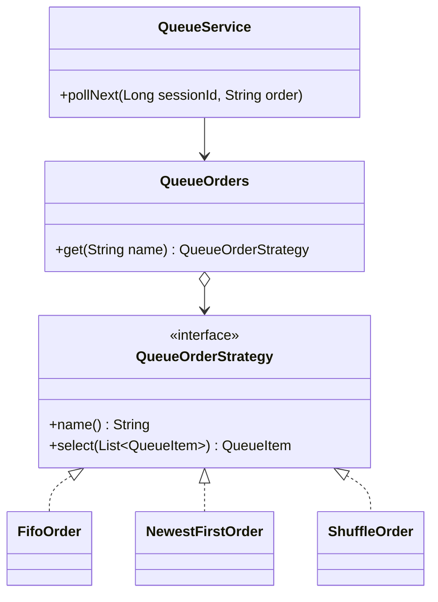
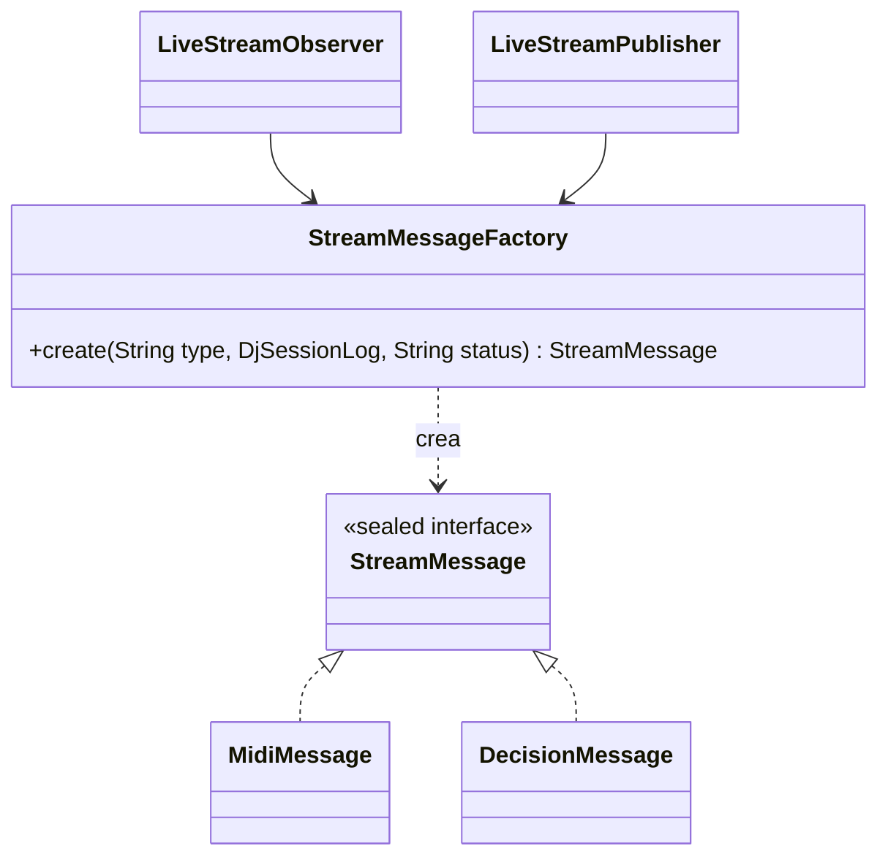

# Patrones de diseño en SoundIA API Core

Trabajo de la materia Patrones de Software: cinco patrones en la lógica del backend Java. Cada uno resuelve un
problema concreto del código; el informe que justifica la elección está en
[`docs/review/2026-10-27-soundia-api-core-pattern-review.md`](review/2026-10-27-soundia-api-core-pattern-review.md).

| # | Patrón | Categoría | Dónde | Problema que resuelve |
|---|---|---|---|---|
| 1 | Observer | Comportamiento | `telemetry/pattern/` | Varias reacciones a un evento MIDI sin acoplarlas |
| 2 | Strategy | Comportamiento | `queue/strategy/` | El orden de la cola estaba fijo en FIFO |
| 3 | Builder | Creacional | `DjSessionLog.builder()`, `autodj/EngineRequestBuilder` | Constructores solapados y mapas armados a mano |
| 4 | Factory Method | Creacional | `telemetry/stream/StreamMessageFactory` | Cada observador decidía qué mensaje SSE crear |
| 5 | Singleton | Creacional | `engine/EngineStatus` | Estado único del motor de IA compartido por varios hilos |

## 1. Observer

**Problema:** cuando llega un evento MIDI hay que consultar a la IA y guardar el resultado, y además avisar al
navegador. Meter todo en el controlador lo acoplaría a cada nueva reacción.

**Solución:** `DjControllerReader` es el sujeto y avisa a todos los `MidiObserver`. Spring entrega los observadores
como beans, así que uno nuevo solo tiene que ser un `@Component`.



`MidiProcessingObserver` consulta a la IA y guarda (asíncrono, con reintentos); `LiveStreamObserver` publica el evento
por SSE. Pruebas: `DjControllerReaderTests`, `MidiProcessingObserverTests`, `LiveStreamObserverTests`.

## 2. Strategy

**Problema:** `QueueService.pollNext` siempre tomaba la primera pista; cambiar el orden obligaba a tocar el servicio.

**Solución:** cada algoritmo de selección es una clase intercambiable. El servicio recibe el nombre (`?order=`) y
`QueueOrders` devuelve la estrategia.



Uso: `POST /api/v1/sessions/{id}/queue/next?order=fifo|newest|shuffle`. Pruebas: `QueueOrderStrategyTests`,
`QueueServiceTests`, `QueueControllerTests`.

## 3. Builder

**Problema:** `DjSessionLog` tenía constructores solapados más setters, y `AutoDjClient` armaba los cuerpos con
`LinkedHashMap` y `Map.of`, con un `if` para el campo opcional.

**Solución:** `DjSessionLog.builder()` (control y valor obligatorios; acción y sesión opcionales) y
`EngineRequestBuilder` (`with` / `withIfPresent`).

```mermaid
classDiagram
    class DjSessionLog {
        +builder() Builder$
    }
    class Builder {
        +controlId(Integer) Builder
        +value(Integer) Builder
        +action(String) Builder
        +sessionId(Long) Builder
        +build() DjSessionLog
    }
    class EngineRequestBuilder {
        +create() EngineRequestBuilder$
        +with(String, Object) EngineRequestBuilder
        +withIfPresent(String, Object) EngineRequestBuilder
        +build() Map
    }
    DjSessionLog +-- Builder
    Builder ..> DjSessionLog : crea
    AutoDjClient ..> EngineRequestBuilder
    MidiEventService ..> Builder
```

Pruebas: `DjSessionLogTests`, `EngineRequestBuilderTests`, `AutoDjClientTests`.

## 4. Factory Method

**Problema:** cada observador decidía qué clase de mensaje SSE construir para su evento.

**Solución:** `StreamMessageFactory.create(tipo, registro, estado)` devuelve el `StreamMessage` que corresponde al
tipo (`StreamEventType`). Quien publica no conoce las clases concretas.



Pruebas: `StreamMessageFactoryTests`, `LiveStreamObserverTests`, `LiveStreamPublisherTests`.

## 5. Singleton

**Problema:** en la nube gratuita el motor de IA se duerme y tarda cerca de un minuto en despertar; hace falta un
estado único, visible para todos los hilos, de si responde o no.

**Solución:** `EngineStatus` con constructor privado e instancia creada de forma perezosa con el idiom del holder;
métodos `synchronized`. Los tres clientes del motor (`IaEngineClient`, `AutoDjClient`, `TrackClient`) lo actualizan con
`track(...)` en cada llamada y `GET /api/v1/engine/status` lo muestra.

```mermaid
classDiagram
    class EngineStatus {
        -EngineStatus()
        +getInstance() EngineStatus$
        +recordSuccess()
        +recordFailure(String reason)
        +snapshot() Snapshot
    }
    class Holder {
        -INSTANCE EngineStatus$
    }
    EngineStatus +-- Holder
    IaEngineClient ..> EngineStatus
    EngineStatusController ..> EngineStatus
```

Como el estado es global, las pruebas que lo tocan llaman a `reset()` antes y después para no depender del orden.
Pruebas: `EngineStatusTests` (incluye concurrencia), `EngineStatusControllerTests`, `IaEngineClientTests`.
